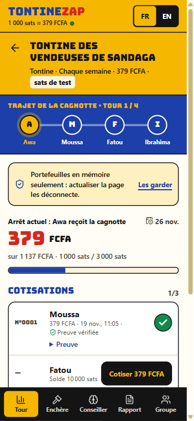
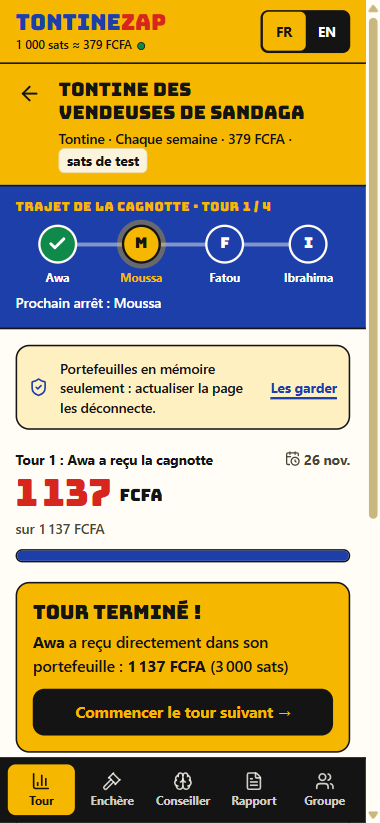
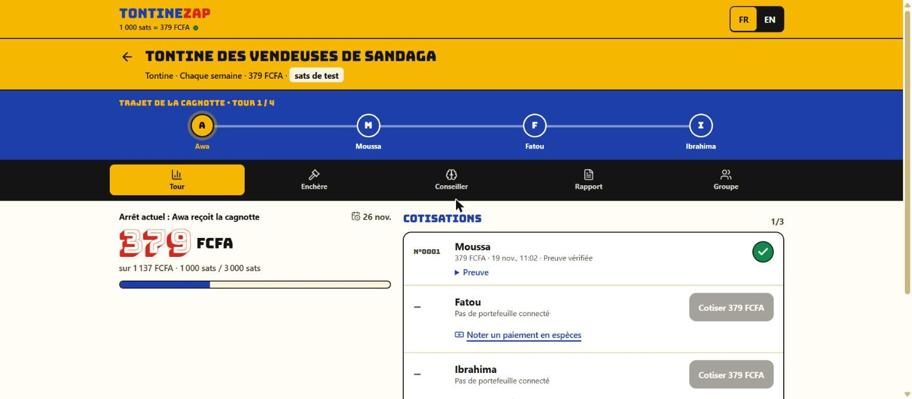
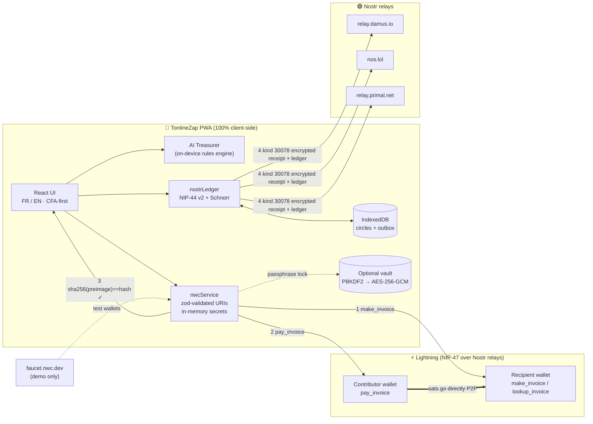

# ⚡ TontineZap

**Chaque culture a sa tontine. Ici, personne ne garde la caisse.**
**Every culture has a savings circle. Here, nobody holds the pot.**

TontineZap is an open-source, zero-custody Progressive Web App for rotating savings circles: the *tontine* of Dakar, the *bhishi* and *kameti* of India, the *tanda* of Mexico, the *susu* of Ghana. Members pay each round's recipient directly over **Bitcoin Lightning** (Nostr Wallet Connect). Every payment carries a cryptographic proof, the circle's **tamper-evident ledger is encrypted and signed on Nostr**, and an on-device **AI Group Treasurer** writes bilingual (FR/EN) WhatsApp-ready audit reports.

| Phone: mid-round | Phone: round complete | Laptop |
|---|---|---|
|  |  |  |

Built for the **Dakar Bitcoin Hack by Btrust** (2026).

**Live demo: https://tontinezap.vercel.app** (tap "Demo: Dakar tontine"; test sats only, no real money)

```bash
npm install && npm run dev      # → http://localhost:5173 → "Launch demo (test sats)"
```

---

## 1. Problem

Across Senegal and West Africa, millions of market vendors, tailors and neighbourhood groups save through *tontines*: each member contributes a fixed amount every week, and each round one member receives the whole pot. The same rotating savings and credit association (ROSCA) runs everywhere: *bhishi*, *kameti* and chit funds in India, *tanda* in Mexico, *susu* in Ghana and the Caribbean, *hui* in China, *gye* in Korea. It powers micro-entrepreneurship, but it runs on:

- **paper ledgers** that get lost, smudged or disputed ("I paid you last Tuesday!"),
- **cash handoffs**, which are risky in a busy market,
- **a single treasurer holding everyone's money**, which is the classic failure point: theft, loss, or simply pressure on one trusted person.

## 2. Solution

| Pain | TontineZap |
|---|---|
| Treasurer holds the cash | **Zero custody.** Each contributor's wallet pays the round's recipient **directly** over Lightning. The app never touches funds. |
| "Did she pay?" disputes | Every payment carries a **cryptographic proof**: `sha256(preimage) == payment_hash`, verified on the phone and confirmed by the recipient's wallet. |
| Paper ledger | Every change is **signed** (Schnorr/NIP-01) and **encrypted** (NIP-44 v2), then published to 3 Nostr relays as kind-30078 app data. It is also stored offline-first in IndexedDB. |
| Urgent business needs | **Emergency bid / reverse auction.** A member can take the pot early for a small discount, and the discount is paid out as a dividend to everyone else. |
| Hard to keep everyone informed | The **AI Treasurer** scores circle health, flags risks (late payers, post-payout defaults, predatory discounts), and writes **French/English audit reports** you can share on WhatsApp in one tap, plus a scannable QR receipt card. |
| Not everyone has Lightning yet | **Hybrid mode.** The organizer can record cash payments; they are shown clearly as "no proof", and the advisor nudges the group toward Lightning. |

**Global by design, Dakar first.** Organizers pick their circle's local name (Tontine, Bhishi, Kameti, Chit fund, Tanda, Susu, Hui, Gye) and its display currency (**CFA franc** or **Indian rupee**, with Indian digit grouping like ₹1,23,456); payments are always in sats. Amounts are shown in local money first, then sats: *"Contribute 5,000 CFA (13,200 sats)"*. The price comes from a live BTC/EUR rate converted at the fixed **655.957 XOF/EUR** peg (mempool.space → CoinGecko → cached → offline fallback).

## 3. Impact

- **Who it's for:** Dakar market vendors (Sandaga, HLM, Colobane), tailors, and neighbourhood savings-circle organizers running 4–12 member weekly or monthly *tontines*.
- **What changes:** the organizer no longer carries the group's cash or the group's trust alone. Every member can verify every payment. A lost phone doesn't lose the ledger, because it lives on Nostr.
- **Runs where they are:** a static PWA under 200 KB gzipped that installs to the home screen, works offline, and needs no account, no server and no app store. It costs **$0** to host.

## 4. Try it in 60 seconds (judges)

1. `npm install && npm run dev`, then open http://localhost:5173 (or the deployed URL).
2. Tap **"Demo: Dakar tontine"** (or **"Demo: Mumbai bhishi (₹)"**). This provisions **4 real, disposable Lightning wallets** from Alby's NWC faucet (`POST https://faucet.nwc.dev?balance=10000`) for *Awa, Moussa, Fatou, Ibrahima* (or *Priya, Rahul, Anjali, Vikram*). If the public faucet hiccups for one member, a "Test wallet" button on that row retries.
3. Optional: open **Enchère / Bid** and let *Fatou* take the pot early at 5%. The quote shows exactly what everyone saves.
4. Tap **"Contribute …"** on a member, or **"Everyone pays now (demo)"**. Watch the 4 steps: invoice → direct payment → proof verified → signed receipt on Nostr. That takes about 1–2 s per payment on test wallets. Each payment gets a receipt number (N°0001…), and when the round closes the yellow pot on the **route plate** slides to the next member's stop.
5. Open **Conseiller / Advisor** for the health score, then **Rapport / Report** for the FR/EN WhatsApp summary and QR receipt card.
6. Open **Groupe / Circle** and **Show code** to open the same circle on a second phone. It syncs from Nostr.

> Demo sats are test sats with **no real value**. The demo screen says so in large type.

### The design: "Painted Route Board"

The interface borrows from the hand-painted transport art that Dakar and India share: Dakar's *car rapide* buses and India's "Horn OK Please" trucks. The circle is a route and every member is a stop. A yellow pot disc sits on whoever receives this round and slides to the next stop when the round closes. Car-rapide yellow, ultramarine and sign-painter lettering are high contrast, so the app reads in direct market sunlight. Green appears only on paid ticks and red only on the pot and overdue items. The full design system is in [`DESIGN.md`](DESIGN.md).

## 5. Architecture



**Nostr event layout** (all kind `30078`, parameterized-replaceable, content NIP-44 v2 encrypted with the circle group key, signed by the circle key):

| `d` tag | Content |
|---|---|
| `tontinezap:<circleId>` | full ledger snapshot (members, rotation, rounds, payments) |
| `tontinezap:<circleId>:r<n>:<memberId>` | per-payment receipt incl. payment hash + preimage proof |
| `tontinezap:<circleId>:audit:r<n>` | treasurer audit summary |

**Project layout**

```
src/
  services/
    nwcService.ts     # NWC client, faucet provisioning, zod validation, vault, preimage verification
    nostrLedger.ts    # NIP-44 + kind 30078 events, relay pool, IndexedDB, offline outbox, invites
    tontine.ts        # "Pay my share" orchestration (invoice → pay → verify → receipt)
  lib/
    circle.ts         # pure domain model: rotation, bids, rounds, receipts, merge
    money.ts          # circle kinds (tontine, bhishi, tanda…) + XOF/INR formatting
    advisor.ts        # health score, insights, reverse-auction math, FR/EN audit text
    rates.ts          # XOF/INR ↔ sats (CoinGecko → mempool → cache → offline)
    redact.ts         # secret/PII redaction, error classification
    vault.ts          # Web Crypto PBKDF2 + AES-GCM
    i18n.ts           # Français / English
  components/         # RoutePlate (signature), Home, CreateCircle, Dashboard, BidPanel, AdvisorPanel, ReportPanel, CirclePanel…
```

**Stack:** Vite 8 · React 18 · TypeScript · Tailwind 4 · `@getalby/sdk` 9 (`NWCClient`) · `nostr-tools` 2.26 · `zod` 4 · `idb-keyval` · `uqr` · `vite-plugin-pwa` 2 · `lucide-react`.

## 6. The emergency bid (reverse auction), explained

A pot normally pays `(n − 1) × c` to the recipient (n members, contribution c). A member in urgent need bids a discount `d`:

- the bidder takes the **current** round's pot now and receives `(n − 1) × c × (1 − d)`,
- every other contributor pays `c × (1 − d)`, so each saves `c × d`, and that saving is their dividend,
- the bidder's slot in the rotation is swapped. Nobody loses their turn.

Bidding closes once anyone has paid into the round. The advisor warns above 5% and flags discounts above 10% as potentially exploitative of a member in distress, which is a known failure mode of bidding ROSCAs.

## 7. The AI Group Treasurer

The advisor is deliberately **deterministic and on-device**. No member data leaves the phone, it runs offline on a low-end Android, and every recommendation can be explained to a non-technical member. It encodes well-known ROSCA risk signals:

- **Punctuality** per member (on-time vs. late vs. overdue).
- **Post-payout default risk**: a member who already received the pot and stops paying. This is the #1 tontine failure mode.
- **Proof quality**: the share of payments with a verified Lightning proof vs. cash on trust.
- **Bid fairness**: discount thresholds.
- **Sync health**: whether the ledger has been confirmed by relays.

It produces a 0–100 health score, prioritized insights, and the FR/EN audit summary. The interface is shaped so an edge-hosted LLM summarizer could be added later without changing the data flow.

## 8. Threat model

| # | Threat | Mitigation | Residual risk |
|---|---|---|---|
| T1 | App or developer steals funds | **Zero custody.** Payments go wallet → wallet over NWC; there is no pool account and no server. | A malicious build could misuse NWC permissions. Use budget-limited NWC connections, and reproducible builds in future. |
| T2 | NWC secret leaks via storage | Secrets live only in an in-memory `Map`. Persistence is opt-in, encrypted with **PBKDF2-SHA256 (600k) → AES-256-GCM**. Form inputs are `type=password`, `autocomplete=off`, and cleared after use. | A device compromised while unlocked. |
| T3 | Secret leaks via logs or errors | `redact()` strips NWC URIs, `secret=`, nsec, BOLT11, 64-hex blobs and phone numbers. SDK loggers are silenced. The error boundary and toasts show redacted text only, and production logs nothing. | — |
| T4 | Malformed or malicious NWC URI | `zod` schema: exact scheme, 32-byte hex pubkey, `wss://` relays only (ws only for localhost), 32-byte hex secret, length caps. | — |
| T5 | Fake "I paid" claims | `sha256(preimage) == payment_hash` is verified locally, plus `lookup_invoice` on the recipient's wallet. Cash entries are explicitly marked *unverified*. | Collusion between the organizer and a member over cash entries. |
| T6 | Ledger tampering or forgery | Events are Schnorr-signed by the circle key, `verifyEvent()` runs on fetch, and zod validates the decrypted schema. | Anyone with the invite code can write (see T8). |
| T7 | Relays reading private data | Content is **NIP-44 v2** encrypted (ECDH + HKDF, ChaCha20, HMAC-SHA256, padding). Relays see only ciphertext, the circle pubkey, a `d` tag and timestamps. | Metadata: activity timing and event counts. |
| T8 | Invite code leak | A clear warning in the UI. The code is shown only on demand. | v1 uses one shared circle key (read **and** write). Roadmap: per-member keys + NIP-29/MLS groups. |
| T9 | Relay censorship or outage | Local-first IndexedDB, a persistent signed **outbox** retried on `online`, and 3 independent relays. | — |
| T10 | XSS / supply chain | React escaping, no `innerHTML` (the QR is rendered as SVG paths from a matrix), a strict **CSP** (`script-src 'self'`, `object-src 'none'`, `frame-ancestors 'none'`), and a minimal dependency set. | `connect-src wss:` must stay open because users choose their own NWC relays. |
| T11 | Price manipulation | Payments are denominated in sats locked at creation. The CFA amount is informational only, and rate sanity bounds are enforced. | — |
| T12 | Lost phone | The ledger can be recovered from Nostr with the invite code. Wallets stay in the member's own wallet app. | — |

See [`SECURITY.md`](SECURITY.md) for the full policy and how to report vulnerabilities.

## 9. Development

```bash
npm install
npm run dev          # local dev server
npm test             # 35 unit tests (redaction, URI validation, proofs, vault, NIP-44, rotation, auction, advisor, merge, route-plate states, receipts, XOF/INR money, legacy data)
npm run test:e2e     # LIVE: 4 faucet wallets, a 5% bid, 3 real Lightning payments, ledger fetched back from Nostr
npm run build        # typecheck + production PWA build → dist/
```

**Deploy:** push to GitHub and import into Vercel or Netlify. `vercel.json`, `netlify.toml` and `public/_headers` already set the SPA routing and security headers (CSP, HSTS, no-referrer). There are no environment variables and no backend.

## 10. Next steps

1. **Per-member Nostr identities** (NIP-07 / NIP-46 signers) and private groups (NIP-29 / MLS) instead of a shared circle key.
2. **Scheduled reminders** via Nostr DMs (NIP-17) and WhatsApp deep links on due dates.
3. **More currencies and languages**: KES, NGN, GHS, MXN alongside XOF and INR; Hindi and Wolof interfaces.
4. **Hold invoices** (`make_hold_invoice`) so a round's pot only settles when *all* members have paid. That gives atomic rounds.
5. Voice prompts for members with low literacy.
6. **Mobile-money bridges** (Wave / Orange Money / UPI ↔ Lightning) for members who aren't on Bitcoin yet.
7. Optional edge LLM summaries layered on top of the deterministic advisor.

## 11. 3-minute demo video script

| Time | Screen | Voice-over |
|---|---|---|
| 0:00–0:20 | Title card, then a photo of a paper tontine notebook | "In Dakar, millions of people save through tontines. Every week, everyone gives money to one member. But it runs on paper notebooks, cash, and one treasurer holding everyone's money." |
| 0:20–0:35 | Home screen on a phone, FR | "TontineZap: la tontine, sans la caisse. Nobody holds the money, and every payment leaves a tamper-proof receipt." |
| 0:35–0:55 | Tap **Lancer la démo**; 4 wallets appear | "For this demo we spin up four real Lightning test wallets for Awa, Moussa, Fatou and Ibrahima, with no account needed. Amounts are shown in CFA first." |
| 0:55–1:25 | **Enchère** tab: Fatou bids 5% | "Fatou needs fabric for a big order today. She bids 5% to take this week's pot early. The app shows everyone what they save, and our treasurer warns if a discount gets unfair." |
| 1:25–2:05 | **Tour** tab: tap *Cotiser*, watch the 4 steps, then **Everyone pays** | "Moussa contributes. Fatou's wallet creates an invoice, Moussa's wallet pays it directly, and the app verifies the cryptographic proof. A signed, encrypted receipt goes to Nostr. Under two seconds. Fatou's balance goes up in real time." |
| 2:05–2:30 | **Conseiller** tab: health score, insights | "Our on-device AI treasurer scores the circle's health and flags the real risks, like a member who got paid and stopped contributing." |
| 2:30–2:45 | **Rapport**: FR/EN summary, WhatsApp, QR card | "One tap shares a plain-French audit report on WhatsApp, with a QR receipt card for members without smartphones." |
| 2:45–2:52 | Home → **Demo: Mumbai bhishi (₹)** | "And because every culture has a savings circle, the same app runs a bhishi in Mumbai, in rupees." |
| 2:52–3:00 | Architecture diagram plus the open-source repo | "Zero custody, open source, under 200 KB, works offline. TontineZap: Lightning for the tontines of Dakar." |

## License

MIT. See [LICENSE](LICENSE).
